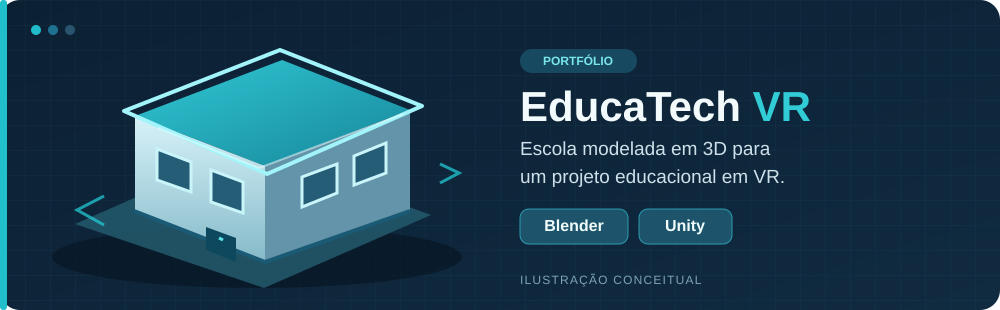
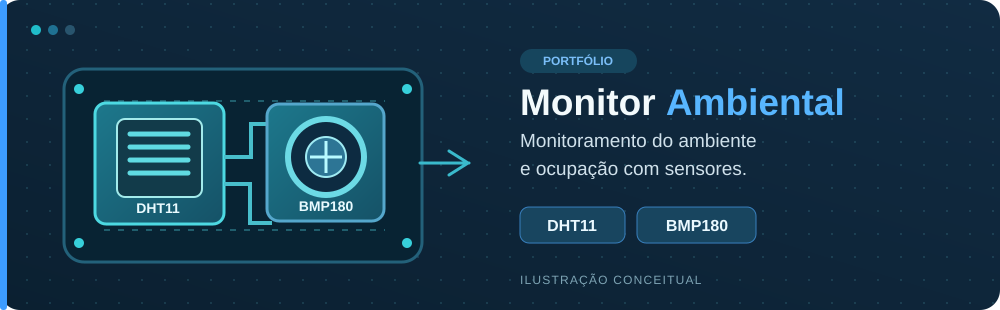

<div align="center">


</div>

<div align="center">

# Gustavo Suzart

**Técnico em Informática em formação | Desenvolvimento, sensores e modelagem 3D**

Bahia, Brasil &nbsp;•&nbsp; Conclusão do curso técnico em 2026

</div>

---

### 01 // TERMINAL

```bash
gustavo@portfolio:~$ whoami
Gustavo Suzart Muniz | Técnico em Informática (formação em 2026)

gustavo@portfolio:~$ ls interesses/
desenvolvimento-web  sensores  modelagem-3d  realidade-virtual

gustavo@portfolio:~$ echo "Construindo, testando e aprendendo."
Construindo, testando e aprendendo.
```

### 02 // SOBRE MIM

Sou estudante do **3º ano do curso Técnico em Informática** no **CEEINFOR – Centro Estadual de Educação, Inovação e Formação da Bahia Mãe Stella**, com conclusão prevista para 2026.

Gosto de transformar ideias em projetos reais, combinando programação, tecnologia, sensores e modelagem 3D. Estou desenvolvendo meu portfólio para iniciar minha trajetória profissional na área de **Tecnologia da Informação**.

- Interesse em desenvolvimento de software, aplicativos e soluções educacionais.
- Experiência prática com **Blender** e **Unity** em projeto escolar.
- Desenvolvimento de um projeto de monitoramento ambiental com sensores.
- Participação na concepção e organização de um projeto de bibliotecas.
- Aprendizado contínuo e evolução técnica.

### 03 // FERRAMENTAS

<p>
  
  
  
</p>

**Áreas que estou explorando:** desenvolvimento de aplicativos com React Native e TypeScript, projetos com sensores e ferramentas de desenvolvimento.

### 04 // ESTATÍSTICAS DO GITHUB

<div align="center">
  
  
  
</div>

Esses indicadores são atualizados automaticamente e mostram apenas informações públicas do GitHub. O gráfico de contribuições completo também aparece na parte inferior do meu perfil.

### 05 // LINGUAGENS E TECNOLOGIAS

<p>
  
  
  
  
  
  
</p>

- **Linguagens de programação:** JavaScript e C#.
- **Tecnologias web:** HTML5 e CSS3.
- **Ambiente de execução:** Node.js.
- **Em estudo:** TypeScript para desenvolvimento de aplicativos com React Native.

Essas são tecnologias com as quais já tive contato ou que estou explorando. Quando eu publicar repositórios com código, poderei mostrar também um ranking das linguagens realmente utilizadas nesses projetos.

### 06 // PROJETOS EM DESTAQUE

#### EducaTech VR — Trabalho de Conclusão de Curso (TCC)



Projeto educacional de **realidade virtual**. Fui responsável pela **modelagem completa do prédio escolar em 3D utilizando Blender** e participei do desenvolvimento da experiência com **Unity**.

`Modelagem 3D` `Blender` `Unity` `Educação` `Realidade virtual`

#### Monitor Ambiental e de Ocupação



Desenvolvi o monitor ambiental e de ocupação apresentado em projeto acadêmico, com uso dos sensores **DHT11** e **BMP180** para acompanhar condições do ambiente.

`Sensores` `DHT11` `BMP180` `Monitoramento ambiental`

*As imagens acima são ilustrações do conceito dos projetos, não capturas de tela reais.*

#### Organização de Bibliotecas

Contribuí com a **ideia original** e ajudei na organização e estruturação de uma solução web para bibliotecas.

> Os repositórios dos projetos estão sendo preparados para apresentação pública no portfólio.

### 07 // OBJETIVO

Busco minha primeira oportunidade profissional em **TI**, onde eu possa aplicar meus conhecimentos, colaborar com equipes e continuar aprendendo por meio de desafios reais.

---

<div align="center">
  <sub>PORTFÓLIO / GUSTAVO SUZART • Obrigado pela visita.</sub>
</div>
